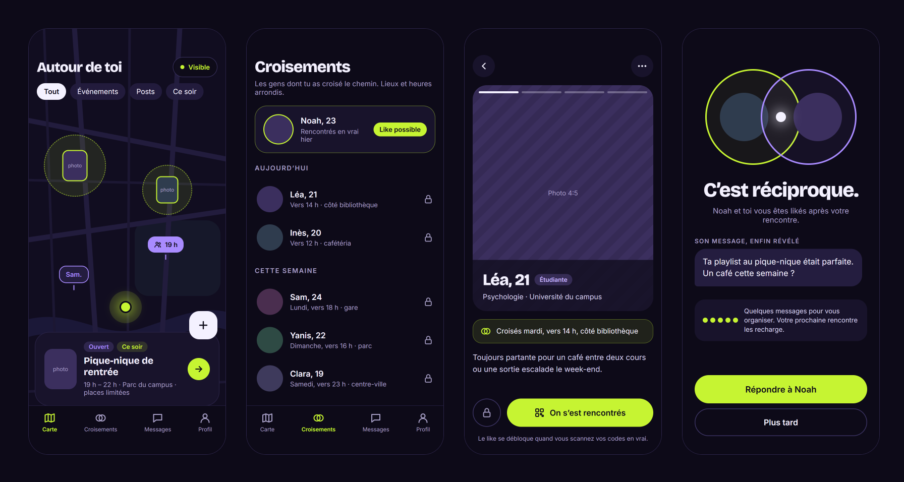
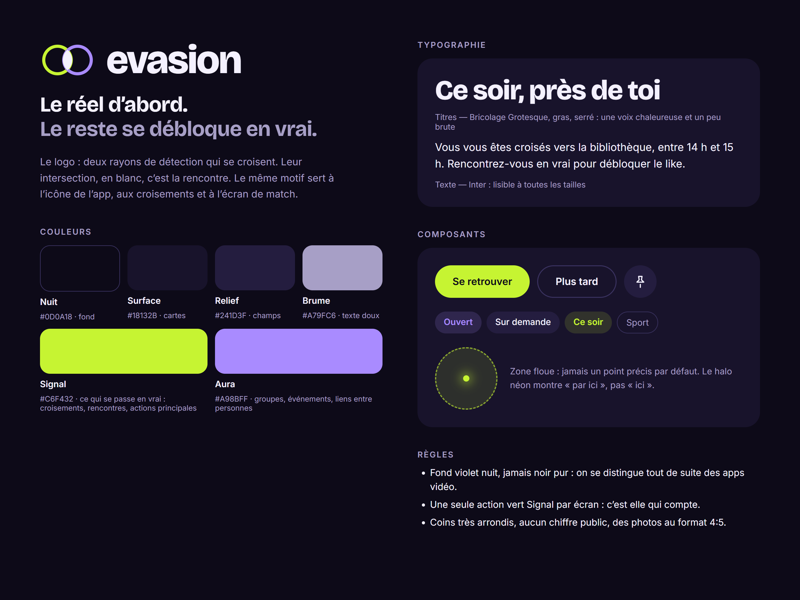

<div align="center">

# Evasion

**The app for meeting people in real life.**

Proximity encounters, ephemeral geolocated posts, groups that become events on a map,
and a like that only unlocks after a real meetup.

[](https://flutter.dev)
[](https://supabase.com)
[](#prerequisites)
[](LICENSE)

<br>



<sub>Design mockups with fictional content. See <a href="#design-preview">Design preview</a>.</sub>

</div>

> **Status: in development.** The app is not yet available on the App Store or the Google Play Store.
> It will launch on a single campus first, then for everyone.
>
> This repository is public to showcase the app and our work. The code remains our property: you may read it, but not reuse it (see [License](#license)).

---

## Contents

- [The concept](#the-concept)
- [Design preview](#design-preview)
- [Features](#features)
- [Tech stack](#tech-stack)
- [Architecture](#architecture)
- [Security and privacy](#security-and-privacy)
- [Getting started](#getting-started)
- [Tests](#tests)
- [Database](#database)
- [How we work](#how-we-work)
- [Authors](#authors)
- [License](#license)

---

## The concept

Most dating and social apps keep people behind their screens. Evasion does the opposite: **real life unlocks the virtual**.

Three principles drive every decision:

| Principle | In practice |
|---|---|
| **Real life unlocks the virtual** | You can only like someone after a real meetup, confirmed by a QR code scanned by both people. After a match, a message quota applies, and a new meetup refills it. |
| **Everyone on the same level** | No public counters: no followers, no likes, no views. Posts are not liked, they are pinned. |
| **Safe by default** | No precise location is ever shown without the person's explicit choice. By default, everything is blurred. |

---

## Design preview

> These are **early design mockups**, made to explore the visual direction. The content is fictional, and the final app may look different.

The direction, called *Night neon*: a deep violet background rather than pure black, one bright green action per screen for what happens in real life, and a logo made of two detection circles that cross. Their intersection is the meetup.



The four screens at the top follow a meetup from start to finish:

1. **See what's around you**: posts and events nearby, always shown as a blurred area by default.
2. **Cross paths**: people you passed by, with rounded places and times. The like stays locked.
3. **Meet in person**: the like unlocks only after a real meetup, confirmed by scanning each other's QR code.
4. **Match**: the message written with the like is revealed, and a message quota encourages meeting again.

---

## Features

| Feature | Description | Status |
|---|---|---|
| Sign-in | One-time code sent by email, no password | ✅ Done |
| Profile setup | First name, birth date, gender and photo, step by step | ✅ Done |
| Student badge | Granted automatically when the confirmed email address belongs to a recognised university | ✅ Done |
| Profile carousel | A main page, plus up to 5 free pages (text, photo, interests) to add, edit and reorder | ✅ Done |
| Profile editing | Texts, photo, and a single correction of the birth date | ✅ Done |
| Settings | Location mode (invisible, foreground; background later), detection radius, encounter criteria | ✅ Done |
| Blocking | A blocked person disappears everywhere: map, encounters, messages, profiles | ✅ Server side |
| Account deletion | Deletes the account, its data and photos, after confirmation with a new email code | ✅ Done |
| Posts | Mandatory photo, blurred location by default, chosen audience (everyone, friends, a list of friends), limited lifetime | 🚧 In progress |
| Map | Posts and events around you | 📋 Planned |
| Encounters | Detection of people you cross paths with, based on mutual criteria; history with rounded area and time | 📋 Planned |
| Real meetups | Confirmed by QR code, which unlocks the like for a limited time | 📋 Planned |
| Friends | Mutual add after a real meetup | 📋 Planned |
| Likes and matches | Secret like with a message revealed only on a match | 📋 Planned |
| Messaging | Private and group conversations | 📋 Planned |
| Groups and events | A public group becomes an event on the map | 📋 Planned |
| Push notifications | Through Firebase Cloud Messaging | 📋 Planned |
| Moderation | Reports and admin tools | 📋 Planned |

---

## Tech stack

| Layer | Technology |
|---|---|
| App | [Flutter](https://flutter.dev) (stable), Dart with null safety |
| State | [Riverpod](https://riverpod.dev) with `riverpod_generator` |
| Navigation | [go_router](https://pub.dev/packages/go_router) |
| Models | [freezed](https://pub.dev/packages/freezed) and `json_serializable` |
| Backend | [Supabase](https://supabase.com): PostgreSQL and PostGIS, Auth, Storage, Realtime, Edge Functions, pg_cron |
| Push notifications | Firebase Cloud Messaging (planned, push only) |
| Tests | `flutter_test`, `mocktail`, and [pgTAP](https://pgtap.org) for the database |
| Language | The app is in French, through the translation files in `lib/l10n/` |

---

## Architecture

### App

The code is organised **by feature**, each split into three layers:

```
lib/
├── main_dev.dart / main_prod.dart   # entry points, one per environment
├── app/                             # theme, router, configuration
├── core/                            # shared code: errors, storage, validation, common widgets
├── l10n/                            # app texts (app_fr.arb)
└── features/
    └── <feature>/
        ├── data/                    # repositories: the only files that call Supabase
        ├── domain/                  # models and business rules, with no Supabase dependency
        └── presentation/            # screens, widgets and Riverpod controllers
```

Features: `auth`, `onboarding`, `profile`, `map`, `posts`, `groups`, `chat`, `encounters`, `connections`, `moderation`, `notifications`, `settings`.

A few rules:

- **A widget never calls Supabase.** The path is always: widget → controller → repository → Supabase.
- **Each repository is an interface** in `domain/`, with its Supabase implementation in `data/`. Tests replace the implementation with a fake one.
- **Errors are typed** (`AppFailure`), never raw exceptions reaching the screen.
- **A feature never imports another feature's internal files.** Shared code goes in `core/`.
- **All thresholds** (durations, quotas, radii, lengths) live in [`lib/core/config/business_rules.dart`](lib/core/config/business_rules.dart). Those that protect data are also enforced by the database.

### Server

```
supabase/
├── migrations/       # the whole schema, one migration per change
├── tests/database/   # pgTAP tests: access policies, constraints, triggers
├── functions/        # Edge Functions (for example delete-account)
├── templates/        # authentication emails
└── config.toml       # local stack configuration
```

Every sensitive rule is enforced **on the server**: constraints, triggers, SQL functions and Edge Functions. The app cannot bypass them, even if modified.

---

## Security and privacy

- **Row Level Security on every table**, with explicit and tested policies.
- **Precise locations are never directly readable.** Other users only see a displayed location, blurred by default, through dedicated views and functions.
- **Blocking is checked by the database** in every query that shows one user to another. A blocked person never learns who blocked them.
- **Private photos**: every storage bucket is private. A photo can only be read by people allowed to see the related profile or post, through temporary links.
- **No secrets in the repository.** The app only uses the project URL and its publishable key. The `service_role` key is never used in the app.

Found a vulnerability? Please **do not open a public issue**: use GitHub's [private vulnerability reporting](https://github.com/Alessio-Mattia/Evasion_App/security/advisories/new).

---

## Getting started

These instructions are for the two authors' development environment. They also show how the project is set up.

### Prerequisites

- [Flutter](https://docs.flutter.dev/get-started/install) (stable channel, Dart 3.13 or later)
- [Docker Desktop](https://www.docker.com/products/docker-desktop/), for the local Supabase stack
- [Supabase CLI](https://supabase.com/docs/guides/local-development/cli/getting-started) 3.x
- For Android: Android Studio and an emulator or a phone
- For iOS: a Mac with Xcode; iOS 15 or later

### 1. Get the project

```bash
git clone https://github.com/Alessio-Mattia/Evasion_App.git
cd Evasion_App
```

### 2. Generate the code

Generated code (translations, models, providers) is not versioned. Run this after every clone or pull:

```bash
flutter pub get
flutter gen-l10n
dart run build_runner build -d
```

### 3. Start Supabase locally

With Docker running:

```bash
supabase start      # starts the local stack and prints the URL and the publishable key
supabase db reset   # applies every migration to an empty database
```

> `supabase start` reuses the existing database. After a pull that adds migrations, run `supabase db reset` again. Note that it deletes the local test accounts.

Sign-in emails (codes) do not reach a real inbox: you can read them in Mailpit, at http://127.0.0.1:54324.

### 4. Configure the environment

Keys are passed to the app at launch, from a JSON file that is never versioned. Copy the template:

```bash
cp env/example.json env/local.json
```

Then fill in the publishable key printed by `supabase start`, and the API URL for your device:

| Device | `SUPABASE_URL` |
|---|---|
| iOS simulator | `http://127.0.0.1:54321` |
| Android emulator | `http://10.0.2.2:54321` |

On a real phone, use a hosted Supabase project instead: create `env/dev.json` or `env/prod.json` the same way, with the URL `https://<ref>.supabase.co` and the project's publishable key.

### 5. Run the app

The `--flavor` option is required: the build fails without it.

```bash
# With the local stack
flutter run --flavor dev -t lib/main_dev.dart --dart-define-from-file=env/local.json

# With a hosted project
flutter run --flavor dev -t lib/main_dev.dart --dart-define-from-file=env/dev.json
flutter run --flavor prod -t lib/main_prod.dart --dart-define-from-file=env/prod.json
```

The `dev` and `prod` flavors install two separate apps on the same device.

---

## Tests

```bash
flutter analyze     # must finish without any warning
flutter test        # unit and widget tests
supabase test db    # pgTAP database tests (local stack running)
```

- **Business rules and controllers**: tested in Dart, with repositories replaced by hand-written fakes.
- **Access policies, constraints and triggers**: tested in SQL with pgTAP, signed in as different users.

---

## Database

**The schema only changes through migrations**, never from the Supabase dashboard.

```bash
supabase migration new <migration_name>   # creates an empty file in supabase/migrations/
supabase db reset                         # replays every migration locally
supabase test db                          # checks that the tests still pass
```

Every new table comes with its Row Level Security policies and its tests, in the same migration.

Migrations are applied to the hosted projects (`dev`, then `prod`) only after being merged into `main`.

---

## How we work

- **`main` is the reference branch.** Every change starts on a branch (`feat/…`, `fix/…`, `docs/…`) and comes back into `main` through a pull request.
- **Every pull request is reviewed** by the other developer before being merged, with `flutter analyze`, `flutter test` and `supabase test db` passing.
- **Code, comments and commit messages in English.** App texts, discussions and reviews in French.
- Ideas and upcoming tasks are tracked on a GitHub Projects board.

### Contributions

Evasion is developed by its two authors only: **outside contributions are not accepted**, and pull requests opened by other people will be closed without being merged.

---

## Authors

Evasion is built by two brothers:

| | Role | GitHub |
|---|---|---|
| **Sirio Mattia** | Server and database: schema, security, Edge Functions | [@Sirio-Mattia](https://github.com/Sirio-Mattia) |
| **Alessio Mattia** | App: screens, navigation, user experience | [@Alessio-Mattia](https://github.com/Alessio-Mattia) |

---

## License

© 2026 Alessio Mattia and Sirio Mattia. **All rights reserved.**

This repository is public for viewing only. No license is granted: apart from viewing and forking on GitHub, as allowed by GitHub's Terms of Service, and without our written permission, you may not use, copy, modify, distribute or reuse all or part of the code, the database schema or the documentation. See the [LICENSE](LICENSE) file.

Third-party libraries used by the project are not part of this repository and remain under their own licenses.
